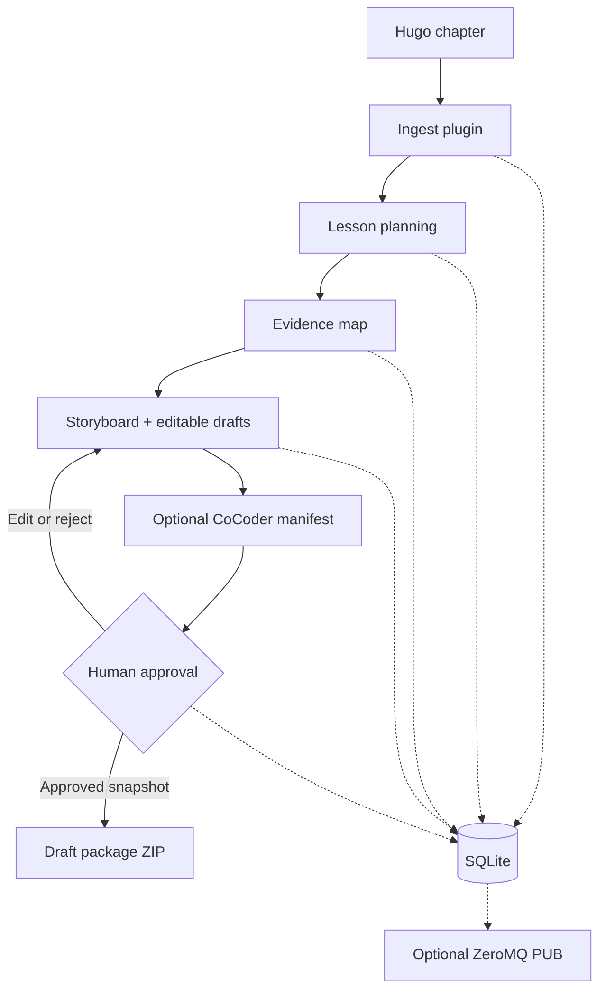

# YT01 Architecture & trust boundaries

**Responsibilities.** Workflow engine runs stages in declared order, enforces dependencies, stores outputs, and exposes replayable events. Hydra controls stage composition. Plugins perform one operation and return typed `StageResult` values. Plugins may not silently claim a successful proof or execution. ZeroMQ is a *best-effort notification bus*: the database is the authoritative event log and subscriber disconnects must not affect the workflow. This is not a distributed job queue.

**Review gate.** The user edits `runs/RUN_ID/drafts/{storyboard.json,narration.md,slides.md,lesson.json,evidence.json}` and runs `approve`. Approval stores a SHA-256 digest of each file in the ordered set. After edits, reapproval is mandatory. Package creation checks the exact approved bytes again. `approve` does not publish to YouTube.

**Security boundaries.** The source root confines chapter and optional CoCoder manifest paths. Package filenames are fixed, avoiding path traversal. External plugins execute with current Python process privileges: plugin allowlisting is NOT a sandbox. Code from chapters is never executed in YT01. No network retrieval of citations or uploading. No credentials or secrets belong in event payloads. Choose only trusted plugin distributions and implement sandboxed execution in a separate YT02 runtime.

**Where to extend.** `research.verify`, `code.steps`, `code.execute`, `capture.terminal`, `diagram.render`, `slides.render`, `voice.synthesize`, `timeline.compose`, `video.render`, `quality.check`, `youtube.publish` are future plugins, not working capabilities in YT01. `youtube.publish` will require a separate explicit approval and credential boundary.

**Operational constraints.** SQLite WAL persists each stage and event; restarts resume completed stages. Single-process worker is intentional. Concurrent multi-process execution and distributed retries need a future atomic lease/claim mechanism. Maximum chapter input and event counts are bounded by config. Reading external plugin distribution metadata is only permitted through the plugin allowlist.
